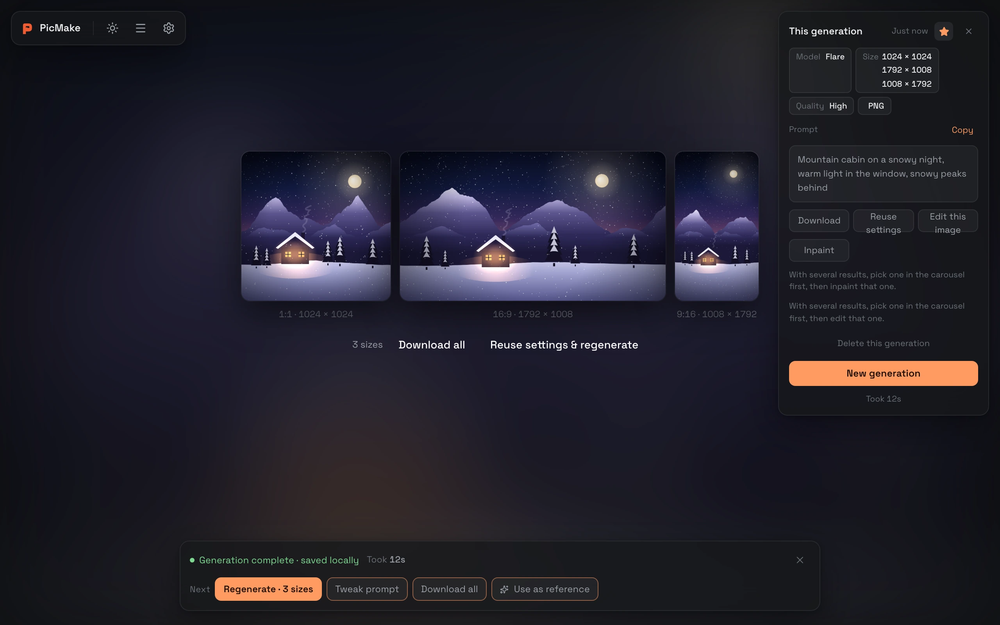
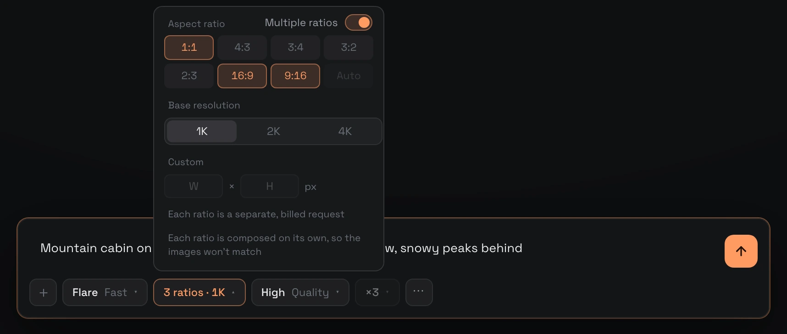
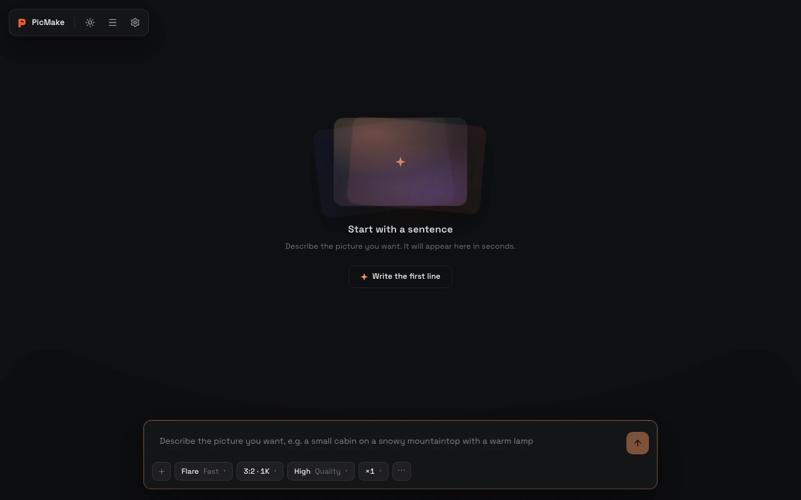
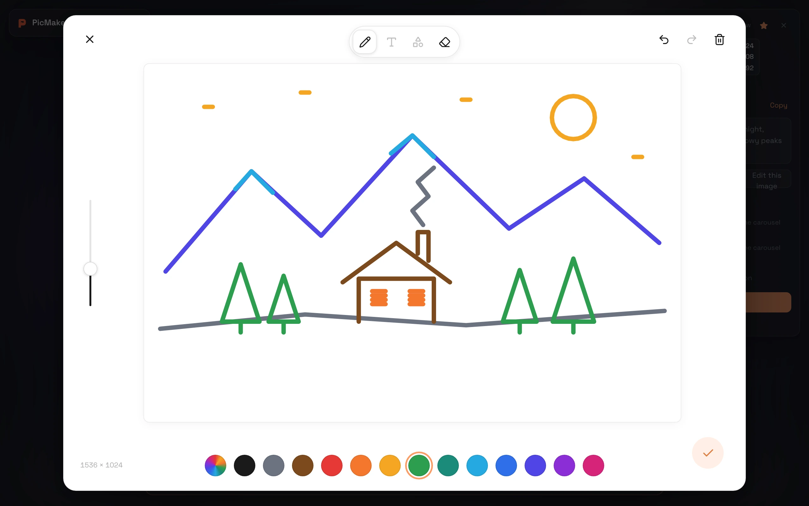
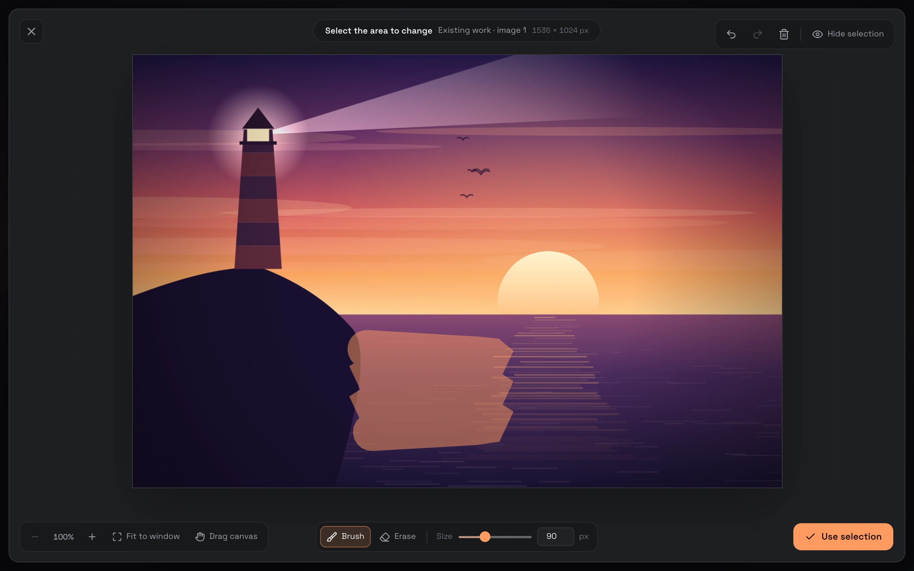
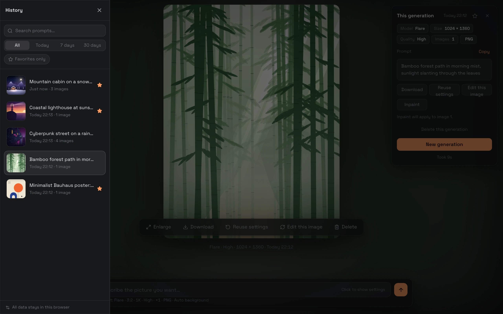
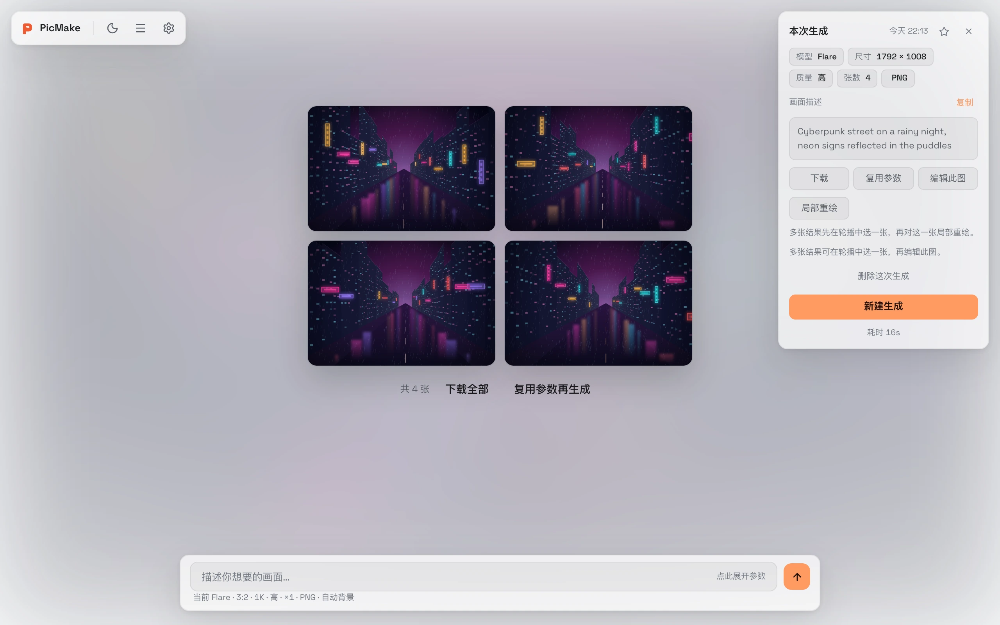
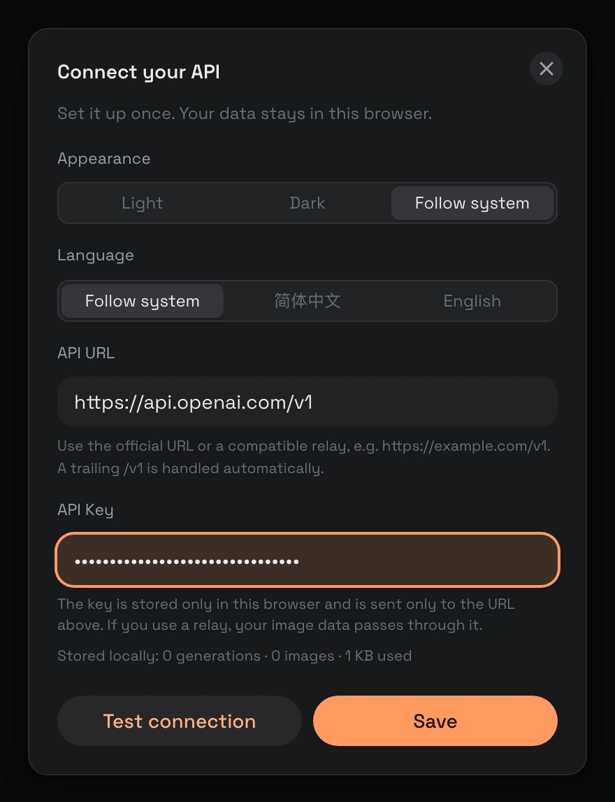

<div align="center">


# PicMake

[简体中文](./README.md) · **English**

**Your API key and your images stay in your own browser.**

A GPT Image 2.5 workspace that runs entirely in the browser: open the page, enter your key, start creating.

[](https://PicMake.crisweb.com)
[](https://github.com/crisweb1994/PicMake/actions/workflows/ci.yml)
[](./LICENSE)

[Live demo](https://PicMake.crisweb.com) · [Features](#features) · [Quick start](#quick-start) · [Deploy](#deploy) · [Privacy](#your-key-and-your-data)

</div>



GPT Image 2.5 is OpenAI's most capable image generation API to date, but it ships as an API only, with no standalone app. In ChatGPT you can't tune its parameters or manage what you've made, and if you use a relay you don't even get a convenient way in. PicMake fills the gap: open the page, enter your own API URL and key, and generate with full control over every parameter and a history that lives on your machine.

| 🔒 Stays on your machine                                                                                    | 🌊 Watch it render                                                                | 🔌 Relay friendly                                                                                                         |
| :---------------------------------------------------------------------------------------------------------- | :-------------------------------------------------------------------------------- | :------------------------------------------------------------------------------------------------------------------------ |
| No backend, no account, no telemetry. Your key lives in localStorage; images and history live in IndexedDB. | Streaming previews sharpen from blurry to final, just like generating in ChatGPT. | Works with the official API or any OpenAI-compatible relay, even ones that ignore streaming or reply with async task IDs. |

## Features

### One prompt, several aspect ratios

Turn on **Multiple ratios** in the size popover and pick 2–4 of them. Each ratio goes out as its own request, all at the same time (each one billed separately), and the results land in a single history entry, side by side, each labeled with its actual pixel size: an avatar, a banner and a vertical poster in one go. If one ratio fails, the others still finish and are saved.



### From blur to sharp, as it renders

Requests stream over SSE (`partial_images: 3`): a blurry preview appears on the stage and sharpens step by step into the final image. You can cancel at any point, and finished images are saved to your local history automatically.



### Sketches, reference images and inpainting

- **Sketch**: rough out the composition, outlines and color blocks on a blank canvas, then use it as an input image; reopen it any time to keep drawing
- **Reference images**: upload PNG / JPEG / WebP or reuse earlier results, up to 16 inputs including sketches; refer to them as "Image 1", "Image 2" in your prompt
- **Inpainting**: paint over the area you want to change, then describe the change. The selection is saved with the result, so you can review it, adjust it and run it again (the selection guides the edit; areas outside it may change too)

| Sketch board                                | Inpainting                                 |
| ------------------------------------------- | ------------------------------------------ |
|  |  |

### Every parameter, exposed

| Parameter  | Options                                                                                                                                                        |
| ---------- | -------------------------------------------------------------------------------------------------------------------------------------------------------------- |
| Model      | Flare (fast) · Sunburst (detailed)                                                                                                                             |
| Ratio      | 1:1 · 4:3 · 3:4 · 3:2 · 2:3 · 16:9 · 9:16 · Auto; turn on Multiple ratios to pick 2–4 at once                                                                  |
| Size       | 1K / 2K / 4K base resolution, or a custom width × height (multiple of 16, ratio between 1:3 and 3:1, long side ≤ 3840, short side ≤ 2160, checked as you type) |
| Quality    | Low · Medium · High · Extra high · Max                                                                                                                         |
| Images     | 1–4                                                                                                                                                            |
| Background | Auto · Transparent · Solid                                                                                                                                     |
| Format     | PNG · JPEG · WebP                                                                                                                                              |

### History that stays local

Every image and generation record is kept in your browser's IndexedDB: search by prompt, filter by date, or show favorites only. After a run you can regenerate, tweak the prompt or use the result as a reference; from any history entry you can reuse its settings, edit the image or inpaint it. Click an image to view it full size, browse multiple results in a carousel, and scroll on the stage to step through your history.



### Light or dark, English or 简体中文

The interface comes in English and Simplified Chinese and follows your browser language by default. The theme can be light, dark or follow the system, with a one-click toggle in the top bar. Your prompts are sent to the model exactly as you wrote them and are never translated.



### And the small things

- If a request succeeds but saving locally fails, the result stays in memory so you can still view and download it, and you're asked to confirm before leaving
- Closing or reloading the page while an image is generating or saving brings up the browser's leave confirmation
- Respects your system's reduced-motion setting

<sub>The images in these screenshots come from a local mock. They are placeholder illustrations, not actual model output.</sub>

## Quick start

**Use it online**: open [PicMake.crisweb.com](https://PicMake.crisweb.com) and enter your API URL and key in the settings dialog (the official `https://api.openai.com/v1` or any OpenAI-compatible relay). Click **Test connection** to check it works, then save and start generating.

<p align="center"></p>

**Run it locally**:

```bash
git clone https://github.com/crisweb1994/PicMake.git
cd PicMake
pnpm install
pnpm dev        # → http://localhost:5173
```

Requires Node ≥ 20.19 and pnpm ≥ 10 (see `.nvmrc` and `engines` in `package.json`).

> [!NOTE]
> Local development works the same way: your key is only written to the browser's localStorage, and no server is involved at any point.

## Deploy

The build output is plain static files, so any static host will do. The repo includes configs for two:

[](https://vercel.com/new/clone?repository-url=https%3A%2F%2Fgithub.com%2Fcrisweb1994%2FPicMake)

- **Vercel**: click the button above, or import the repo at [vercel.com/new](https://vercel.com/new); `vercel.json` already declares the build command and output directory
- **Cloudflare Pages**: connect the repo in the dashboard with build command `pnpm build` and output directory `dist` (declared in `wrangler.toml`), or upload directly with `pnpm build && npx wrangler pages deploy dist`

> [!TIP]
> Leave the Pages project's Deploy command empty; Cloudflare uploads `dist` automatically after the build. Don't use `npx wrangler deploy`: it deploys a Worker script and fails on a static-only project with `Missing entry-point`.

## Using a relay

PicMake only sends standard OpenAI image requests (`/images/generations` and `/images/edits`), and handles relays like this:

- **URL normalization**: with or without `/v1`, with or without a trailing slash, it works
- **No streaming support needed**: if a relay ignores `stream` and returns plain JSON, the response is parsed as is
- **Async task APIs**: if a relay returns a `task_id`, PicMake polls the task until the image is ready (every 3 seconds, for up to 5 minutes)
- **Never resends on failure**: no automatic retries and no fallback requests, so a resend never bills you twice for the same images; to try again, click Generate yourself
- **Direct browser requests**: requests go straight from your browser, so the API URL must allow cross-origin requests (CORS). The official API does; if you use a relay, make sure it accepts browser requests

## Your key and your data

> [!IMPORTANT]
> Your API key is stored only in the browser's localStorage and is sent only in the `Authorization` header to the API URL you configure. There's no account, no backend, no analytics or telemetry; images and history are written only to IndexedDB.

- Apart from the UI font, which loads from Google Fonts, the page only talks to your configured API URL (and the image URLs it returns)
- With a relay, your prompts and images pass through the relay operator
- Your local data is the only copy: clearing site data deletes your key, images and history together, so download anything you want to keep
- A browser-only app can't protect against same-origin XSS: use it in an environment you trust, and don't save your key on shared devices

## Development

| Command      | What it does                                                    |
| ------------ | --------------------------------------------------------------- |
| `pnpm dev`   | Dev server (5173)                                               |
| `pnpm build` | Type check + production build                                   |
| `pnpm test`  | Vitest unit tests                                               |
| `pnpm e2e`   | Playwright smoke tests (built-in mock)                          |
| `pnpm check` | Lint + formatting + i18n check + unit tests + build, same as CI |
| `pnpm mock`  | Local mock API (8787)                                           |

Run `pnpm exec playwright install chromium` once before your first `pnpm e2e`. Issues and PRs are welcome; please run `pnpm check` before submitting.

<details>
<summary><b>Local mock API</b>: test errors without spending credits</summary>

```bash
pnpm mock       # → http://localhost:8787
```

Set the API URL to `http://localhost:8787` in settings; any key works. The mock returns solid-color PNGs at the requested size. Add markers to your prompt to simulate failures: `[401]`, `[403]`, `[429]`, `[500]` and `[policy]` return the matching errors, `[stream-error]` breaks the stream after the first preview, `[slow]` slows events down so you can test cancelling, and `[json]` returns a non-streaming JSON response. With multiple ratios each ratio is its own request, and a marker applies to all of them by default; add `@<width>x<height>` (e.g. `[429@1792x1008]`, `[slow@1792x1008]`) to target a single size, which is handy for testing partial failures and keeping finished images when you cancel.

</details>

## Tech stack

Vite 8 · React 19 · TypeScript 6 · Tailwind CSS v4 · HeroUI v3 · Zustand · Dexie · i18next · eventsource-parser · perfect-freehand. The network layer is a thin wrapper around native fetch (`/v1` normalization, error normalization, a single streaming request), with no axios and no official SDK.

## License

[MIT](./LICENSE) © Cris Wang

---

<div align="center">

⭐ If PicMake helps you, a [star](https://github.com/crisweb1994/PicMake) would mean a lot.

</div>
