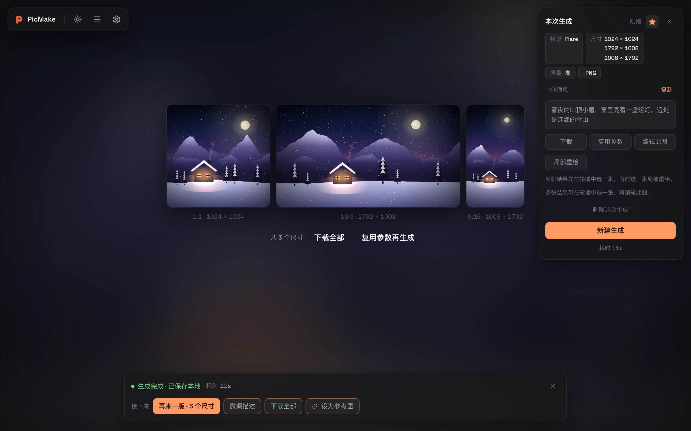
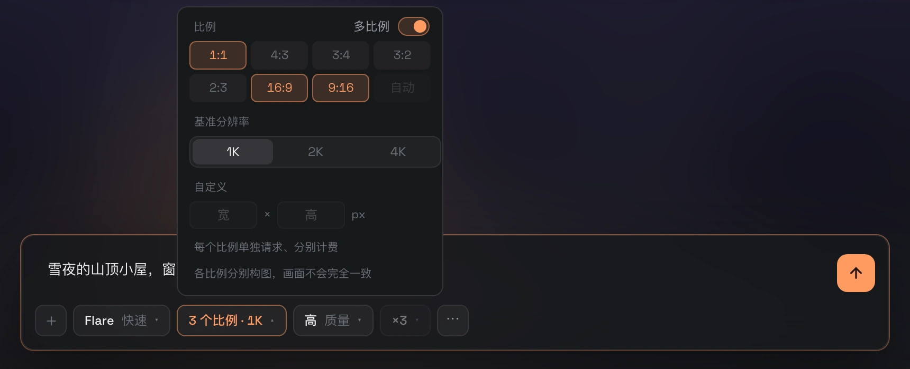
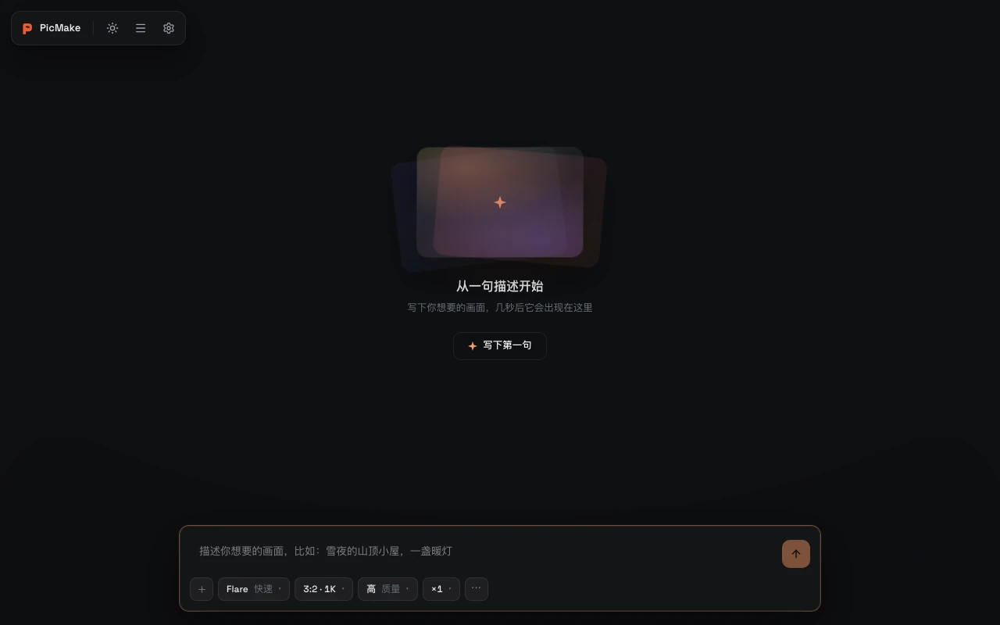
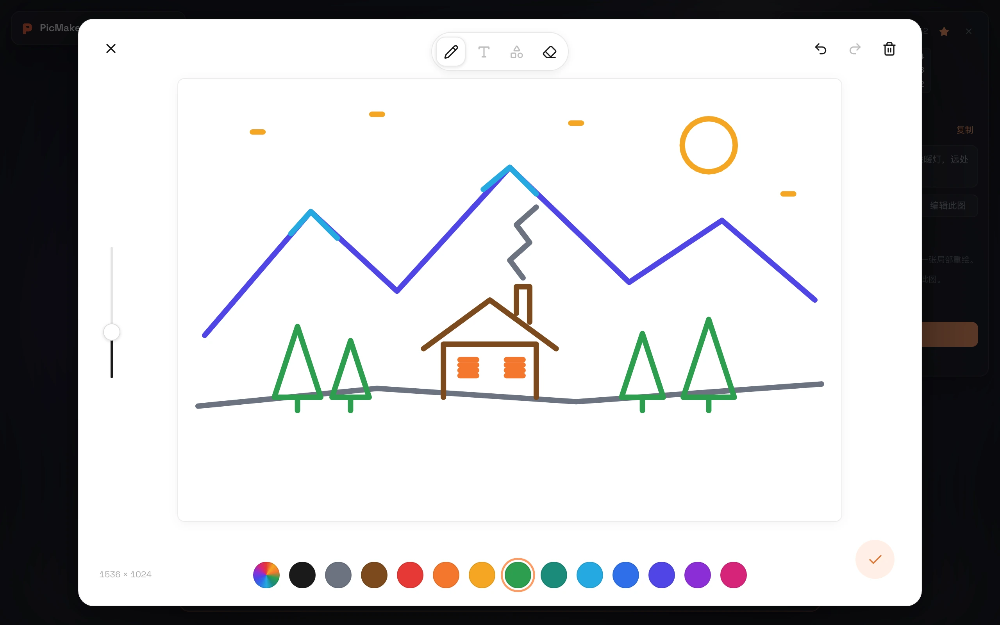
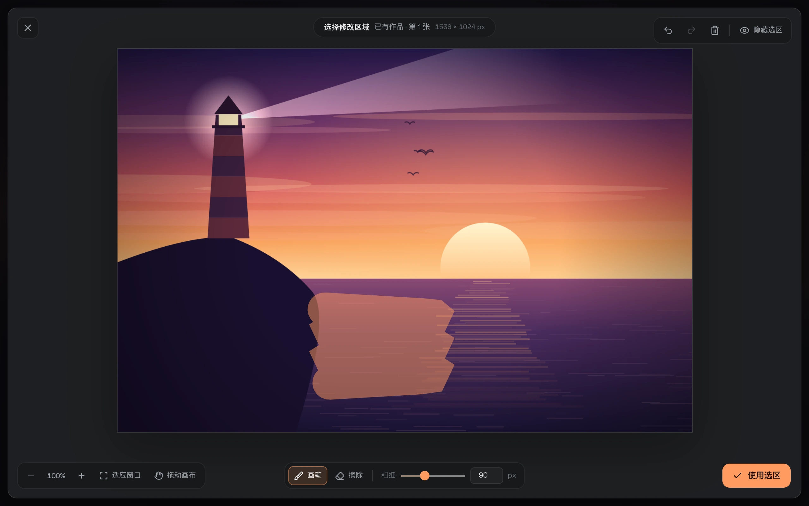
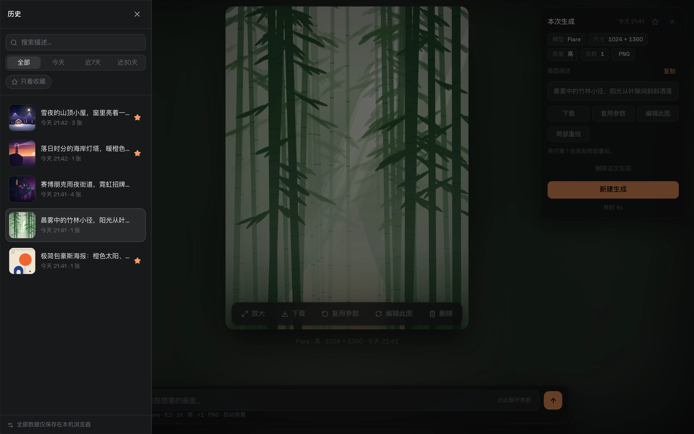
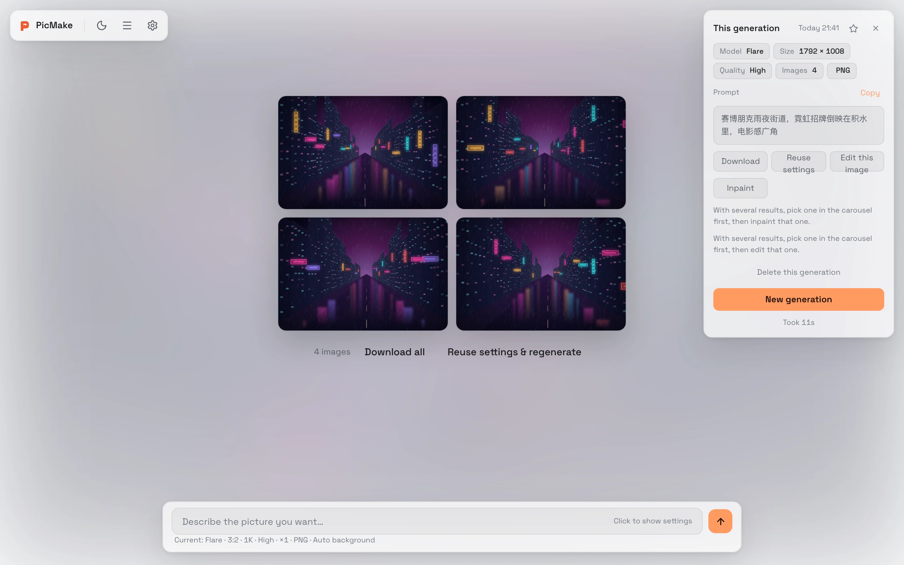
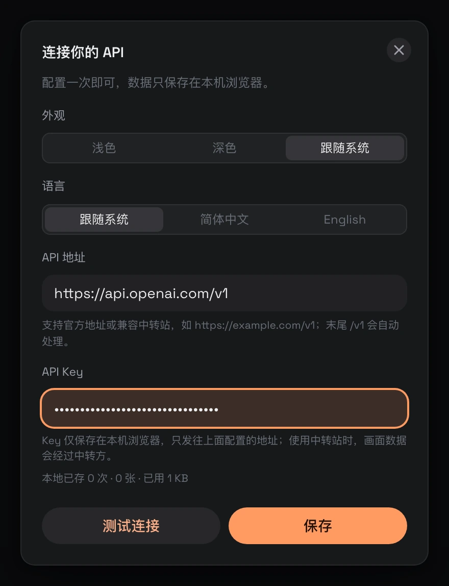

<div align="center">


# PicMake

[English](./README.md) · **简体中文**

**你的 Key、你的图，都只留在你自己的浏览器里。**

GPT Image 2.5 生图工作台：纯前端，打开网页、填上 Key 就能画。

[](https://PicMake.crisweb.com)
[](https://github.com/crisweb1994/PicMake/actions/workflows/ci.yml)
[](./LICENSE)

[在线体验](https://PicMake.crisweb.com) · [功能一览](#功能一览) · [快速开始](#快速开始) · [部署](#部署) · [数据边界](#key-与数据的边界)

</div>



GPT Image 2.5 是 OpenAI 目前最强的生图 API，但官方只给了 API，没有独立客户端；在 ChatGPT 里用又调不了参数、管不了历史；走中转站的用户更是连个顺手的入口都没有。PicMake 补的就是这块：打开网页，填上自己的 API 地址和 Key，就能带着完整的参数控制和本地历史生图。

| 🔒 数据只在本机                                                           | 🌊 看着它画出来                                               | 🔌 中转站友好                                                                    |
| :------------------------------------------------------------------------ | :------------------------------------------------------------ | :------------------------------------------------------------------------------- |
| 无后端、无账号、无遥测。Key 只存 localStorage，作品与记录只存 IndexedDB。 | SSE 流式渐进预览，从模糊到清晰，和 ChatGPT 里出图的观感一致。 | 官方接口或任意 OpenAI 兼容中转站都能接；不支持流式、只返回任务单的中转也能出图。 |

## 功能一览

### 一段描述，同时出多个比例

打开尺寸弹层里的「多比例」，一次选 2–4 个比例。每个比例单独请求、同时发出（也分别计费），结果合成一条记录并排展示，每张都标注实际像素——头像、横幅、竖版海报一次拿齐。某个比例失败不影响其他比例，成功的照常保存。



### 看着它从模糊变清晰

请求走 SSE 流式渲染（`partial_images: 3`）：舞台上先出现模糊的预览，再逐级清晰到终稿，过程中随时可以取消；完成后自动存进本地历史。



### 草图、参考图与局部重绘

- **画草图**：在白纸画板上随手画构图、轮廓和色块，确认后作为输入图；之后还能打开接着改
- **参考图**：上传 PNG / JPEG / WebP，或把已有作品设为参考图，连草图最多 16 张；描述里用「图1」「图2」说清楚怎么用
- **局部重绘**：在图上涂出要改的区域，再描述怎么改。选区随记录保存，可以回看、调整后再来一版（选区用于引导修改，选区外也可能有变化）

| 草图画板                             | 局部重绘                              |
| ------------------------------------ | ------------------------------------- |
|  |  |

### 参数一个不少

| 参数 | 可选                                                                                            |
| ---- | ----------------------------------------------------------------------------------------------- |
| 模型 | Flare（快速）· Sunburst（精细）                                                                 |
| 比例 | 1:1 · 4:3 · 3:4 · 3:2 · 2:3 · 16:9 · 9:16 · 自动；开启「多比例」可一次选 2–4 个                 |
| 尺寸 | 1K / 2K / 4K 基准，或自定义宽高（16 的倍数、比例 1:3～3:1、长边 ≤ 3840、短边 ≤ 2160，实时校验） |
| 质量 | 低 · 中 · 高 · 超高 · 最高                                                                      |
| 张数 | 1–4                                                                                             |
| 背景 | 自动 · 透明 · 纯色                                                                              |
| 格式 | PNG · JPEG · WebP                                                                               |

### 历史全在本地

作品和生成记录都存在浏览器的 IndexedDB 里：按描述搜索、按日期筛选、只看收藏。生成完可以再来一版、微调描述、设为参考图；翻到任何一条历史，也能复用参数、编辑此图或局部重绘。点图进灯箱看大图，多张结果可以轮播；在舞台上滚动滚轮，就能前后翻看记录。



### 浅色 / 深色，中文 / English

界面支持简体中文与 English，默认跟随浏览器语言；主题可选浅色、深色或跟随系统，顶栏一键切换。你写的画面描述原样发给模型，不做翻译。



### 还有这些细节

- 请求成功但本地保存失败时，结果留在内存里，照样能看、能下载，离开前会再确认
- 生成或保存进行中关闭页面，浏览器会先弹出离开确认
- 尊重系统的「减少动态效果」设置

<sub>截图里的图片由本地 mock 生成，是示意插画，不代表模型的实际出图效果。</sub>

## 快速开始

**在线使用**：打开 [PicMake.crisweb.com](https://PicMake.crisweb.com)，在弹出的设置里填 API 地址与 Key（官方 `https://api.openai.com/v1`，或任意 OpenAI 格式兼容的中转站），点「测试连接」确认可用，保存后就能开始生成。

<p align="center"></p>

**本地运行**：

```bash
git clone https://github.com/crisweb1994/PicMake.git
cd PicMake
pnpm install
pnpm dev        # → http://localhost:5173
```

环境要求 Node ≥ 20.19、pnpm ≥ 10（见 `.nvmrc` 与 `package.json` 的 `engines`）。

> [!NOTE]
> 本地开发同理：Key 只写进浏览器 localStorage，全程没有任何服务器参与。

## 部署

构建产物是纯静态文件，任意静态托管都能用，仓库已带两家的配置：

[](https://vercel.com/new/clone?repository-url=https%3A%2F%2Fgithub.com%2Fcrisweb1994%2FPicMake)

- **Vercel**：点上面的按钮，或在 [vercel.com/new](https://vercel.com/new) 导入仓库，`vercel.json` 已声明构建与输出目录
- **Cloudflare Pages**：面板连接仓库，构建命令 `pnpm build`、输出目录 `dist`（`wrangler.toml` 已声明）；或 `pnpm build && npx wrangler pages deploy dist` 直接上传

> [!TIP]
> Pages 项目的 Deploy command 保持留空即可，构建完成后 Cloudflare 会自动上传 `dist`。不要填 `npx wrangler deploy`——那是部署 Worker 脚本的命令，对纯静态项目会报 `Missing entry-point`。

## 接入中转站

PicMake 只发标准的 OpenAI 图片请求（`/images/generations`、`/images/edits`），并对中转站做了这些兼容：

- **地址自动补全**：带不带 `/v1`、带不带尾斜杠都能用
- **不支持流式也能出图**：中转忽略 `stream`、直接回普通 JSON 时，就地解析
- **异步任务型接口**：返回 `task_id` 的中转，自动轮询任务取回图片（每 3 秒一次，最长 5 分钟）
- **失败绝不自动重发**：没有自动重试，也没有自动降级，同一批图不会因为重发被计费两次；要重来，由你再点一次「生成」
- **浏览器直连**：请求从浏览器直接发出，API 地址需要允许跨域（CORS）。官方接口支持；用中转站时请确认它允许浏览器调用

## Key 与数据的边界

> [!IMPORTANT]
> API Key 只存浏览器 localStorage，只在请求头 `Authorization` 中发往你配置的地址。本应用无账号、无后端、无埋点和遥测；图片与历史只写 IndexedDB。

- 除了界面字体从 Google Fonts 加载，页面只请求你配置的 API 地址（以及它返回的图片链接）
- 使用中转站时，画面描述和图片会经过中转方
- 本地数据是唯一的副本：清除站点数据会把 Key、图片和历史一并删除，重要的图记得及时下载
- 纯前端应用挡不住同源 XSS：请在自己信任的环境中使用，不要在公共设备上保存 Key

## 开发

| 命令         | 作用                                             |
| ------------ | ------------------------------------------------ |
| `pnpm dev`   | 开发服务器（5173）                               |
| `pnpm build` | 类型检查 + 生产构建                              |
| `pnpm test`  | Vitest 单元测试                                  |
| `pnpm e2e`   | Playwright 冒烟测试（自带 mock）                 |
| `pnpm check` | lint + 格式 + 文案检查 + 单测 + 构建，与 CI 相同 |
| `pnpm mock`  | 本地 mock API（8787）                            |

首次运行 `pnpm e2e` 前先执行 `pnpm exec playwright install chromium`。欢迎提 Issue 和 PR，提交前跑一遍 `pnpm check`。

<details>
<summary><b>本地 mock API</b>：不花额度，也能触发各种错误</summary>

```bash
pnpm mock       # → http://localhost:8787
```

在设置里把 API 地址填为 `http://localhost:8787`，Key 随便填。mock 返回按请求尺寸生成的纯色 PNG；在画面描述里加 `[401]`、`[403]`、`[429]`、`[500]`、`[policy]` 模拟对应错误，`[stream-error]` 模拟流式中断，`[slow]` 放慢事件便于测试取消，`[json]` 走非流式 JSON 响应。多尺寸生成每个比例是独立请求，标记默认让所有比例一起触发；在标记里加 `@宽x高`（如 `[429@1792x1008]`、`[slow@1792x1008]`）只让该尺寸的请求触发，用来验证部分失败与取消时保留已完成的图。

</details>

## 技术栈

Vite 8 · React 19 · TypeScript 6 · Tailwind CSS v4 · HeroUI v3 · Zustand · Dexie · i18next · eventsource-parser · perfect-freehand。网络层是原生 fetch 封装（`/v1` 归一化、错误归一化、单次流式请求），不引 axios，也不引官方 SDK。

## 许可

[MIT](./LICENSE) © Cris Wang

---

<div align="center">

⭐ 如果 PicMake 帮到了你，欢迎 [点个 star](https://github.com/crisweb1994/PicMake)。

</div>
